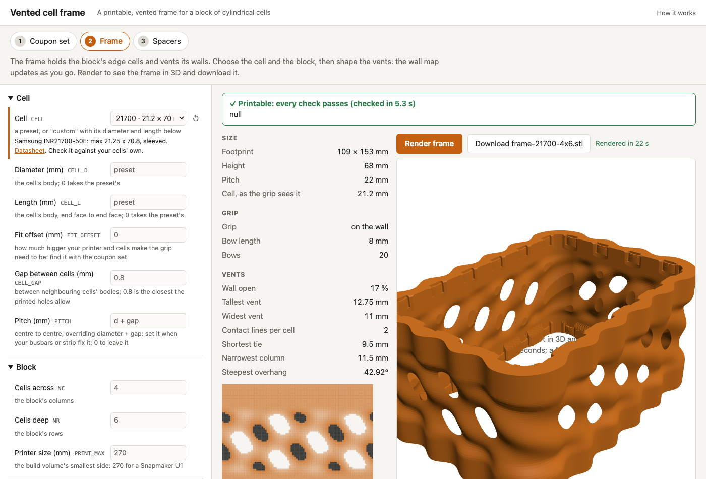

# Vented cell frame

A printable frame for a block of cylindrical cells (18650 to 66160), drawn in OpenSCAD. Choose a cell and an
`NC × NR` array, and it draws an open-ended box the cells stand in, running their full length:

- **It grips every edge cell** with printed bow springs in a band near each end.
- **Its walls are vented.** Between the bands each wall is a wave that touches each cell along a few lines and opens
  into a pattern of vents, so the frame doesn't trap the cells' heat. With the cells lying on their sides, the
  wave's troughs are channels the warm air rises through.
- **It prints standing, without supports.** Asserts hold every face under 45°.



The cells inside the block are held by loose **gap spacers** (`spacer.scad`), one in each diagonal gap near each end.

The frame does not touch the cells' ends. It stops 1 mm short of each end face, so terminals, busbars and nickel
strip stay clear.

## 1. Print the coupon set first

Printers print holes a little small or large, and cells of one format vary by maker. `FIT_OFFSET` shifts the whole
grip to match your printer and cells. The coupon set finds it in one print: three 2 × 2 corners of the frame, each at
a different offset cut into its tab.

```sh
uv run tools/coupon_set.py --cell 21700                  # offsets -0.2, 0, +0.2
uv run tools/coupon_set.py --cell 21700 --centre 0.2 --step 0.05   # refine round the best one
```

Print it in the plastic you'll use for the frame. Push four of your cells into each coupon:

- **Right:** a cell goes in with a firm push and does not wobble.
- **Too loose:** it falls out when you turn the coupon over.
- **Too tight:** you can't push it in by hand.

Set the best offset as `FIT_OFFSET` for the frame and the spacers. Give the coupon set the same cell, gap or pitch,
and grip as the frame you'll print (pass them with `-D`), because the coupon is a corner of that frame.

## 2. Configure and print the frame

There are three ways to set it up:

- **The configurator.** `configurator/` is a page that runs OpenSCAD in your browser: it checks each change as you
  make it, showing what the design works out to (pitch, footprint, grip, vent area, steepest face) or why it is
  refused, and renders the frame, a coupon set or a spacer to view and download. Serve the repository and open it:

  ```sh
  python3 -m http.server 8000      # from the repository's root
  # then open http://localhost:8000/configurator/
  ```

  A coupon set renders in about 4 s; a 4 × 6 frame of 21700s in about 25 s, and of 33140s in about 80 s. The page loads OpenSCAD (WebAssembly, from
  the `openscad-playground` package) and three.js from jsDelivr, so it needs a network connection.
- **OpenSCAD's Customizer.** Open `frame.scad` in OpenSCAD, show the Customizer (Window → Customizer) and set
  values there.
- **The command line:**

  ```sh
  openscad --backend=manifold -o frame.stl -D 'CELL="21700"' -D NC=5 -D NR=4 -D FIT_OFFSET=0.1 frame.scad
  openscad --backend=manifold -o spacer.stl -D 'CELL="21700"' -D CELL_GAP=2 spacer.scad
  ```

  You can also keep your settings in a file of your own: `include <frame.scad>`, followed by your values.

Every input has a plain name in the configurator and the Customizer, and a short name in the `.scad` file for `-D`
on the command line. Every input has a default worked out from the cell. These are the ones most builds change:

| Input | What it sets |
|---|---|
| `CELL` | A preset (below), or `"custom"` with `CELL_D` and `CELL_L`. |
| `NC`, `NR` | Cells across and up the block. |
| `FIT_OFFSET` | From the coupon set. |
| `CELL_GAP` | The gap between neighbouring cells' bodies. 0.8 mm is the closest the printed holes allow. |
| `PITCH` | The cell pitch, overriding diameter + gap. Use it when your busbars or nickel strip set it. |
| `GRIP` | `auto`, `gap` or `wall`; see "Grip" below. |
| `PRINT_MAX` | Your printer's build volume, its smallest side. Default 270 mm (Snapmaker U1). |

Print standing, with the cells' axis vertical and no supports. The grip was tested in PETG with a 0.4 mm nozzle. The
bows are two lines thick (`BOW_T`); a different nozzle needs `BOW_T`, `NECK_MIN` and `WALL_T` to match.

A full frame needs an OpenSCAD with the Manifold backend, which a 2024 or later development snapshot has
(<https://openscad.org/downloads.html#snapshots>). It renders a 4 × 6 frame in about 20 s. OpenSCAD 2021.01 can
check a design, but takes hours to render one.

## Grip

The grip is a bow spring: a thin curved wall in a pocket, rooted at both ends and bulging toward its cell. Its sizes
are millimetres set by the nozzle and the plastic, not by the cell, so they stay the same for every cell. The cell
only sets where the spring sits.

| `GRIP` | Where the bows sit |
|---|---|
| `gap` | In each gap between two edge cells, a ridge holds a bow facing each of its cells, as a gap spacer does. The bow is as long as the gap allows, up to `BOW_SPAN` (8 mm), and no shorter than `BOW_SPAN_MIN` (5 mm). |
| `wall` | A pad on the wall in front of each edge cell's middle holds a full 8 mm bow, with the wall behind it. The ridges in the gaps stay, as plain lands. |
| `auto` | `gap` where the gap holds a bow of at least `BOW_SPAN_MIN`, else `wall`. |

At the default gap, 18650 and 21700 take the wall grip. Their diagonal gaps hold only a 2.5–3.7 mm bow, too short to
spring. For the same reason they have no gap spacers unless you widen `CELL_GAP`.

**Tested:** the gap grip with an 8 mm bow, on a 33140 cell at a 34 mm pitch. The wall grip, and gap bows shorter than
8 mm (the 26650's is 5.6 mm), are untested. The coupon set is the test, so print it first.

## Shaping the vents

Between the bands, the wall's inside face is two sine waves added together. One runs along the wall, with a crest at
each cell's middle; the other runs up the frame. The outside mirrors the inside about a datum, and the wall opens
wherever the inside passes it. Each input changes the vents in its own way:

| Setting | What it changes |
|---|---|
| Waves per cell (`WAVES_PER_CELL`) | How many waves run along the wall per cell. More waves give narrower vents and more of them. |
| Vent shape (`ALONG_SHARE`) | How the depth is split between the two waves. 0.5 gives round, staggered vents; toward 0.7, the vents join into tall slots; below about 0.35, the columns between vents get too thin. |
| Wave height (`UP_WAVELENGTH`) | How far apart the up-the-frame wave's crests stand: shorter for more, shorter vents, longer for fewer, taller ones. Each crest is a line where the wall touches the cell. |
| Trough depth (`CHANNEL`) | How deep the troughs are: deeper troughs open bigger vents and leave wider air channels beside the cells. |
| Crest press (`CREST_PRESS`) | How far the crests press into the cell's land, which sets the size of the contact patches. |
| Mirror (`MIRROR`) | How far the outside mirrors the inside: 1 is a full mirror; less gives a thicker wall and smaller vents. |
| Wave position (`UP_PHASE`) | Where the up-the-frame crests fall: 90° spaces the contact lines evenly between the bands, 0° the vents. |
| Stagger (`STAGGER`) | How far the pattern shifts from one cell to the next: 0.5 staggers the vents like brick bond, 0 lines them up in rows. |

Whatever you set, the asserts keep the frame printable and strong. They refuse a face steeper than 45°, a tie or
column between vents narrower than `TIE_MIN` or `COLUMN_SHARE` of the along-the-wall wavelength, and a wall less than
`OPEN_MIN` open. The configurator draws the wall unrolled as you change values, and lists the tallest and widest vent,
so you can see the result before rendering.

## Cell presets

Presets live in `presets/cells.json`. After editing that file, run `uv run tools/gen_cells.py`; it writes
`lib/cells.scad`, the Customizer's dropdowns and the table below.

<!-- presets:begin -->
| Preset | Diameter × length (mm) | Basis | Datasheet |
|---|---|---|---|
| 18650 | 18.5 × 65 (VERIFY) | Samsung INR18650-35E: max 18.55 x 65.25 overall | [link](https://cdn.shopify.com/s/files/1/0613/3327/4870/files/35eDatasheet.pdf) |
| 21700 | 21.2 × 70 (VERIFY) | Samsung INR21700-50E: max 21.25 x 70.8, sleeved | [link](https://static.rapidonline.com/pdf/10-5180_v1.pdf) |
| 26650 | 26 × 65 (VERIFY) | A123 ANR26650M1-B: 25.96 sleeved x 65.15; other makers run to 26.5 | [link](https://bto.pl/files/Karty%20katalogowe/a123%20datasheet_26650m1b.pdf) |
| 32650 | 32.3 × 65 (VERIFY) | no datasheet found | none found |
| 32700 | 32.4 × 70.5 (VERIFY) | LiFePO4 32700 6 Ah (HX-TS-066): 32.4 +-0.3 sleeved x 70.5 +0.4/-0.3 | [link](https://rcscomponents.kiev.ua/datasheets/HX-TS-066_32700.pdf) |
| 33140 | 33.3 × 140.5 (VERIFY) | IFR33140 15 Ah: 33.3 +-0.2 x 140.5 +-0.5; fit-tested: a 33.2 fit (FIT_OFFSET -0.1) | [link](https://www.rcscomponents.kiev.ua/datasheets/IFR33140_C33.pdf) |
| 40135 | 40.2 × 135 (VERIFY) | no datasheet found | none found |
| 4680 | 46 × 80 (VERIFY) | nominal, from teardowns; no datasheet published | none found |
| 66160 | 66 × 160 (VERIFY) | Yinlong LTO 66160 40 Ah: 66 +-1 x 161 +-1 (whether 161 includes the studs is unclear) | [link](https://akkudoktor.net/uploads/short-url/7z7F1IhRYdLJHxtDF272lAQIx4q.pdf) |
<!-- presets:end -->

Every row is a starting point: check it against the datasheet of the cells you have. 18650 is the smallest cell
supported. A custom cell smaller than that is drawn if it passes the asserts, but it is untested.

The frame needs a cell about 52–58 mm long or more, depending on the diameter and the grip. A shorter frame leaves
room between its bands for no more than slivers of vent, and is refused (`OPEN_MIN`). The 65 mm cells clear it, with
one line of contact each. 18350, 18500 and sub-C cells are too short.

## What the asserts refuse

A design that breaks a rule stops with a message rather than drawing an unprintable or weak part:

- a face steeper than 45°;
- a tie across the wall shorter than `TIE_MIN`, or a column narrower than `COLUMN_SHARE` of the along-the-wall
  wavelength (`TIE_MIN` at least);
- a wave that never opens the wall, opens less than `OPEN_MIN` of it, or doesn't close evenly round the frame;
- a frame bigger than `PRINT_MAX`, or too short for its wave;
- a gap grip where the gap holds no bow.

## Development

```sh
uv run pytest                        # finds OpenSCAD from $OPENSCAD, PATH, or /Applications
uv run tools/gen_cells.py --check    # the generated preset files match presets/cells.json
uv run tools/gen_params.py           # after changing a part's Customizer inputs
```

| Path | What it is |
|---|---|
| `frame.scad`, `spacer.scad`, `coupon.scad` | The parts, each with its inputs in Customizer sections. |
| `lib/grip.scad` | The bow, its pocket, and the cell and pitch they follow from. |
| `lib/cells.scad` | Generated presets. |
| `presets/cells.json` | The presets' one source. |
| `tools/` | The coupon set, the generator, the OpenSCAD finder. |
| `configurator/` | The browser page; `params.json` is its form, generated from the parts by `tools/gen_params.py`. |
| `tests/` | Headless checks of every part and preset. |

## Licence

CERN Open Hardware Licence Version 2, Strongly Reciprocal (`CERN-OHL-S-2.0`); see `LICENSE`. If you distribute a
modified design, or parts made from one, publish your modified source under the same licence.

The configurator bundles Noto Sans (`configurator/fonts/`, SIL Open Font License 1.1, see `OFL.txt`) for the coupons'
labels. It loads OpenSCAD, which is GPL-2.0-or-later, at run time; OpenSCAD is not part of this repository.
